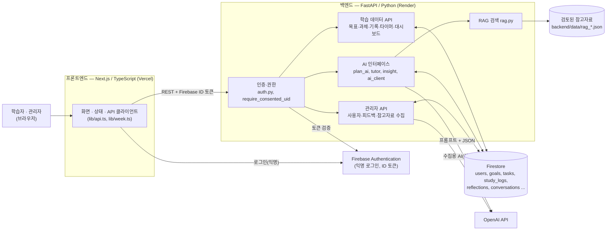
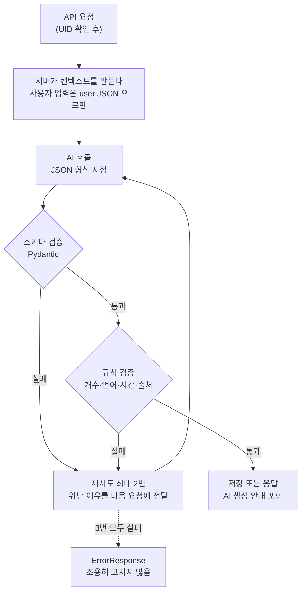
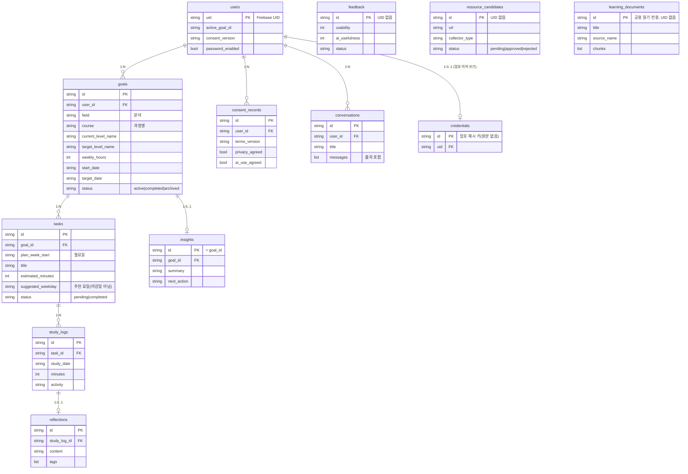

# PaceMate 시스템 아키텍처

작성: PM, 2026-11-10 (CR-016). 근거: 코드를 직접 읽고 썼다(`backend/main.py`, `auth.py`, `ai_client.py`, `rag.py`, `plan_ai.py`, `tutor.py`, `password_auth.py`, `firebase/firestore.rules`, `README.md` §6·§8). 이 문서는 **구조와 경계**를 설명하고, 화면별 데이터 흐름은 `docs/dfd_by_module.md`, 데이터 구조는 `docs/erd_current.md`, API 계약은 `docs/phase1_design.md` 가 맡는다. 서비스기획서의 그림(`images/PaceMate_서비스구조_*.png`)은 소개용이고 이 문서가 정식 기술 자료다.
**확인 수준:** 코드 읽기로 쓴 것이며 그림 렌더링과 배포 환경의 설정값(환경변수)은 이 문서에서 재확인하지 않았다.

## 1. 구성도 (누가 무엇을 부르는가)
화살표는 **요청을 보내는 방향**이다. 프론트는 DB 와 AI 를 직접 부르지 않는다.

| 계층 | 기술 | 선택 이유(요약, 상세는 PRD §10) |
|---|---|---|
| 프론트 | Next.js, TypeScript, Vercel | 화면 상태 관리와 정적 배포가 쉬움 |
| 백엔드 | Python FastAPI, Render | AI·검증 코드를 Python 으로, Pydantic 으로 요청·AI 응답을 같은 방식으로 검증 |
| 인증·DB | Firebase 익명 인증, Firestore | 가입 없이 시작, 서버 SDK 로 UID 격리 |
| AI | OpenAI API(백엔드에서만 호출) | 키를 브라우저에 두지 않음 |

## 2. 인증 흐름과 UID 규칙
1. 프론트가 Firebase 익명 로그인으로 **ID 토큰**을 받는다. 개인 정보 입력은 없다.
2. **동의 전**에는 개인 데이터를 만들지 않는다. 동의하면 `users`·`consent_records` 가 생긴다. 동의가 필요한 API 는 `require_consented_uid` 를 통과해야 한다.
3. 서버는 모든 요청에서 `Authorization: Bearer <토큰>` 을 검증해 **UID 를 토큰에서만** 정한다. 요청 본문의 `user_id`·소유 정보는 믿지 않는다(`auth.py`, `main.py` `require_consented_uid`).
4. 모든 저장 문서에 `user_id` 가 있고, 조회·수정은 `user_id == UID` 로 걸러진다. 다른 사람 문서는 404/403 이다.
5. **다른 기기에서 이어 쓰기(CR-005)**: 익명 사용자가 메뉴에서 암호를 등록하면, 다른 기기에서 암호만으로 같은 UID 의 로그인 토큰을 받는다(`password_auth.py`). 암호는 느린 해시와 서버 비밀값(`AUTH_PEPPER`)으로만 저장하고, IP별·UID별 시도 횟수를 제한한다. 기본은 꺼짐이고 `PASSWORD_LOGIN_ENABLED` 로 켠다.
6. **로컬 모드**: `AUTH_MODE=dev`, `STORE_BACKEND=memory` 로 키 없이 개발한다. **배포(Render)에서는 서버가 이 값들을 거부하고 시작하지 않는다**(`deploy_config.py`). `/health` 가 현재 모드를 알려 준다(CR-001).

## 3. 보안 경계

| 경계 | 지키는 방법 | 어디에 있나 |
|---|---|---|
| 브라우저 ↔ 서버 | HTTPS, CORS 허용 목록(`CORS_ORIGINS`; `*`·localhost·http 는 배포에서 거부) | `main.py`, `deploy_config.py` |
| 사용자 ↔ 사용자 | UID 를 토큰에서만 정함, 모든 문서에 `user_id` | `auth.py`, `main.py` |
| 일반 ↔ 관리자 | `ADMIN_UIDS` 목록에 검증된 UID 가 있어야 함. 요청의 헤더·본문으로 승격 불가 | `main.py` `require_admin_uid` |
| 클라이언트 ↔ Firestore | **프론트는 Firestore 를 쓰지 않는다.** 보안 규칙은 클라이언트의 모든 쓰기를 막고 본인 문서 읽기만 허용, `credentials` 는 읽기·쓰기 모두 금지(서버는 Admin SDK 라 규칙과 무관하게 코드로 소유를 확인) | `firebase/firestore.rules` |
| 서버 ↔ AI | AI 는 서버에서만 호출. 사용자 입력은 system 프롬프트에 끼우지 않고 user JSON 으로만 전달 | `prompts.py`, `ai_client.py` |
| 서버 ↔ 외부 주소 | 관리자 참고자료 수집은 허용 도메인(`allowed_domains.json`)만, SSRF 방어 검사 | `link_checker.py`, `resource_urls.py` |
| 비밀값 | `.env`·Render 환경변수에만. 코드·문서·로그·채팅에 쓰지 않음 | `CLAUDE.md` |
| 로그 | 사용자 입력 원문, 회고, AI 응답 원문, 토큰은 남기지 않고 실패 종류만 | `ai_client.py` |

운영 중 발견한 사례: 배포 시 Firestore 콘솔에 게시된 규칙이 저장소 규칙이 아니라 생성 시의 "테스트 모드"였다(2026-10-28 발견, 10-29 저장소 규칙 게시, `docs/change_management.md` CR-005). 규칙 파일은 **저장소에 있는 것이 게시된 것과 같은지 확인**해야 한다.

## 4. AI 호출 구조
JSON 결과를 받는 AI 호출은 모두 아래 흐름이다. 단, 계획 생성의 ①②단계는 자유 글을 받는 호출이라 스키마 검증이 없다(표 참고). 상세와 프롬프트 목록은 `docs/ai_prompt_inventory.md`.

| 기능 | 호출 | 특징 |
|---|---|---|
| 학습 경로(직무 예시, 과정·수준 추천) | 1~2회 | 입력이 영어여도 한국어로 출력(CR-003) |
| **계획 생성** | **3단계(CR-012)**: ① 영역별 학습 설계 지침 → ② 지침+학습자 조건으로 설계 의견 → ③ JSON(과제·조언) | 계획 전용 모델(`OPENAI_PLAN_MODEL`, 기본 `gpt-5.4-mini`), 주차 배치는 AI 가 아니라 서버(`schedule.py`)가 계산. ①②는 자유 글이라 스키마 검증 없이 시간 초과나 빈 응답일 때만 최대 2번 시도하고, **③만** 스키마·규칙 검증과 재시도(최대 2번)를 거친다. 전체에 **시간 예산 170초**가 있어(브라우저는 200초 대기) 남은 시간이 10초 미만이면 새 시도를 시작하지 않고 시간 초과 오류를 낸다. 한 번의 시도는 최대 60초(`OPENAI_PLAN_TIMEOUT_SECONDS`) |
| AI 튜터 | 질문마다 1회 | **RAG + Long-term Memory**(아래). 학습 관련 질문만 답함 |
| 학습 인사이트 | 회고 2건 이상이면 자세히, 아니면 기본형(기록·회고가 최소 기준에 못 미치면 만들지 않음) | 횟수·분 같은 숫자는 서버가 계산해 전달(AI 가 계산하지 않음, IMP-003) |
| 관리자 수집(선택) | 후보 분류·주제 링크 제안 | 외부 페이지 내용은 "신뢰하지 않는 데이터"로 표시, 허용 도메인만 |

- **모델과 제한 시간:** 계획 생성 외의 호출(학습 경로, 튜터, 인사이트, 관리자 수집)은 `OPENAI_MODEL`(기본 `gpt-4o-mini`)을 쓰고, 한 번의 시도는 최대 20초(`OPENAI_TIMEOUT_SECONDS`)다. JSON 호출의 시도는 처음 1번 + 재시도 2번으로 최대 3번이다(`ai_client.py` `MAX_RETRIES = 2`).

### RAG 와 Long-term Memory (튜터)
- **RAG**: 팀이 사람 검토한 짧은 한국어 요약(`rag_chunks.json`, `verified: true` 만)과 문서 메타데이터(`rag_documents.json`)만 검색한다. **임베딩이나 외부 검색을 쓰지 않는 어휘(키워드) 기반 검색**이다(`rag.py`): 질문 토큰이 청크 키워드와 맞으면 +3, 본문과 맞으면 +1, 합이 3 이상이면 후보, 상위 3개를 AI 에 `reference_chunks` 로 전달한다. 기준에 못 미치면 "검토된 자료로 답하지 못함"으로 표시하고 근거가 있는 것처럼 보이지 않는다. 출처는 AI 가 아니라 **서버가** 붙인다(IMP-002).
- **Long-term Memory**: 사용자별 실행 기록·회고(태그 포함)를 Firestore(`study_logs`, `reflections`)에 저장하고, 튜터 요청마다 진행 중 학습 요약과 최근 회고 최대 5건을 `learning_summary`·`recent_reflections` 로 프롬프트에 넣는다. 사용자 입력은 인덱스에 쓰지 않는다.
- 이 둘이 미션의 "필수 기술 요소 2개 이상" 충족 근거다(`서비스기획서.md` 5장).

## 5. 데이터와 쓰기 규칙 (구조 요약)
- 컬렉션: `users`, `consent_records`, `goals`, `tasks`, `study_logs`, `reflections`, `conversations`, `insights`, `credentials`, 관리자용 `feedback`·`resource_candidates` 등(전체와 필드: `docs/erd_current.md`).
### 핵심 데이터 관계 (ERD 요약)
아래는 `docs/erd_current.md` 의 ERD 에서 **관계와 핵심 필드만** 옮긴 요약이다. 전체 필드, 제약, 결정 이력은 원본이 기준이다. 모든 개인 데이터는 `user_id`(= Firebase UID, 토큰에서만 정함)를 갖고, 사용자별로만 조회된다.

- `feedback`, `resource_candidates`, `learning_documents` 는 사용자(UID)와 연결되지 않는다. `learning_documents` 는 팀이 검토한 공용 읽기 전용 자료이고, `resource_candidates` 는 관리자가 검토해 승인한 것만 `learning_documents` 에 반영된다.
- 진행률은 `tasks` 의 완료 수 ÷ 전체 수이고, 튜터의 Long-term Memory 는 `study_logs`·`reflections` 를 쓴다(4장).

### 쓰기 규칙
- 계획은 **확정할 때만 저장**한다(`POST /api/plan/confirm` 이 목표와 과제를 함께 저장). 초안 생성은 저장하지 않는다.
- 쓰기 요청은 `client_request_id` 로 **멱등** 처리한다(응답을 못 받고 재시도해도 중복 저장 없음).
- 날짜와 주간 경계(월~일)는 서비스 시간대 **Asia/Seoul** 이고, 백엔드는 `clock.py`, 프론트는 `lib/week.ts` 만 쓴다.
- 추천 요일은 마감일이 아니다. 놓쳐도 연체·실패·자동 이월 처리를 하지 않는다.

## 6. 배포 구성
| 구성 | 위치 | 비고 |
|---|---|---|
| 프론트 | Vercel(`https://ai-n-fprj.vercel.app/`) | 배포 연결 방식은 `deploy_guide.md` 를 따른다(이 문서에서 재확인 안 함) |
| 백엔드 | Render(무료 플랜은 유휴 후 첫 요청이 느림, 화면이 대기 안내와 GET 재시도를 한다 — CR-002) | `main` push 시 재배포됨(변경관리 문서의 push 기록과 같은 운영 방식). 환경변수로 모드·키 설정 |
| 인증·DB | Firebase 프로젝트 하나(모든 값이 같은 프로젝트) | 규칙은 `firebase/firestore.rules` |
| 소스 | GitHub `main` | 변경 기록 `docs/change_management.md` |
| 환경 안전장치 | 배포 환경에서 dev 인증, 메모리 저장소, 위험한 CORS, 빈 비밀값이면 서버가 시작을 거부 | `deploy_config.py`, `README.md` §8 |

절차와 환경변수: `docs/deploy_guide.md`, 배포 전 점검: `docs/pre_deploy_checklist.md`.

## 7. 알려진 한계 (아키텍처 관점)
- Render 무료 플랜의 콜드 스타트(첫 요청 지연).
- RAG 는 어휘 기반이라 표현이 달라지면 못 찾을 수 있다(자료가 적은 분야는 "자료 없음"으로 정직하게 표시). 임베딩 검색은 MVP 이후 후보다.
- 암호 시도 횟수 제한은 메모리에만 있어 서버 재시작 시 초기화된다(`password_auth.py` 주석).
- Function Calling 기반 Agent, 리마인더 자동화, 멀티모달은 MVP 에서 제외했다(`서비스기획서.md` 10장, `docs/post_mvp_backlog.md`).
