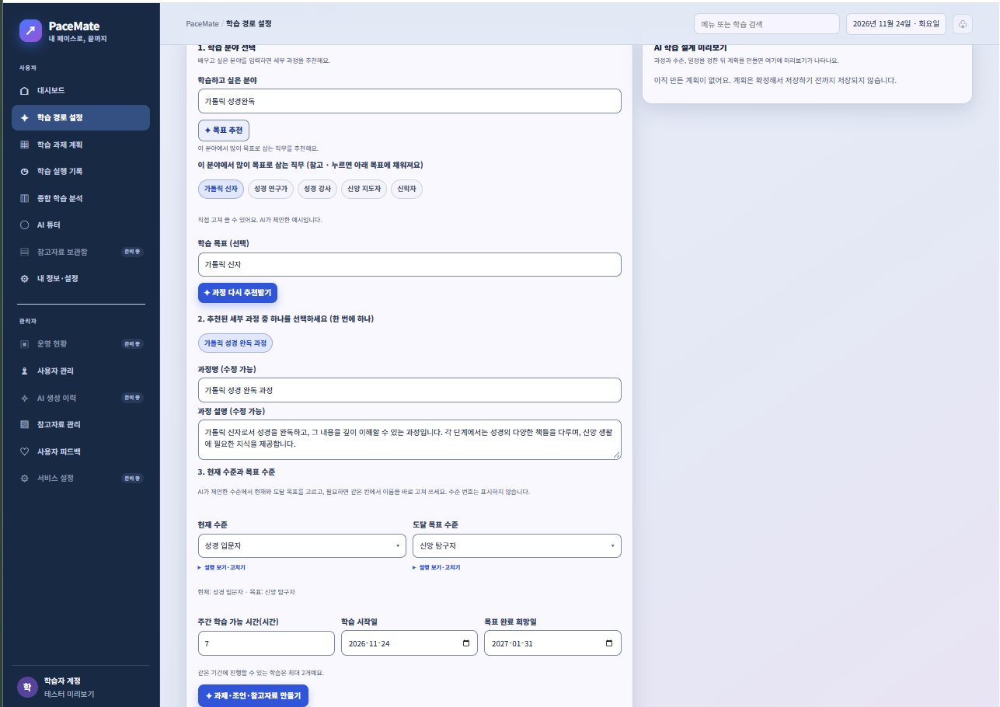
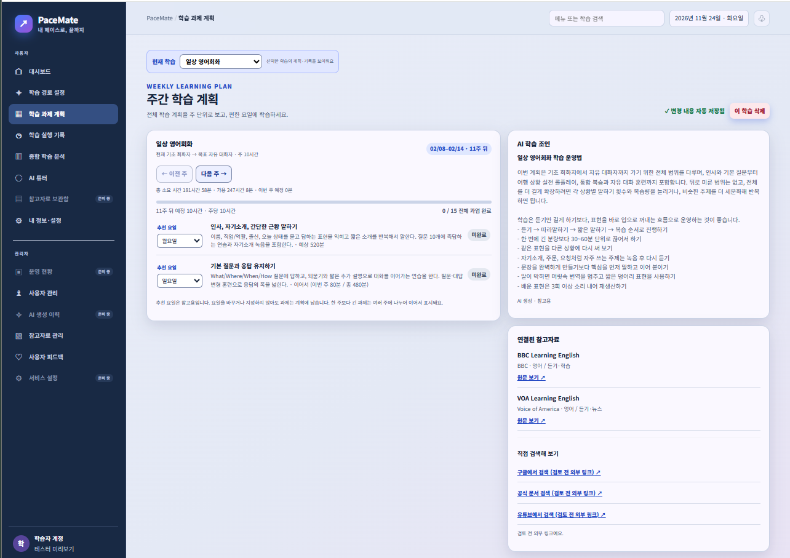
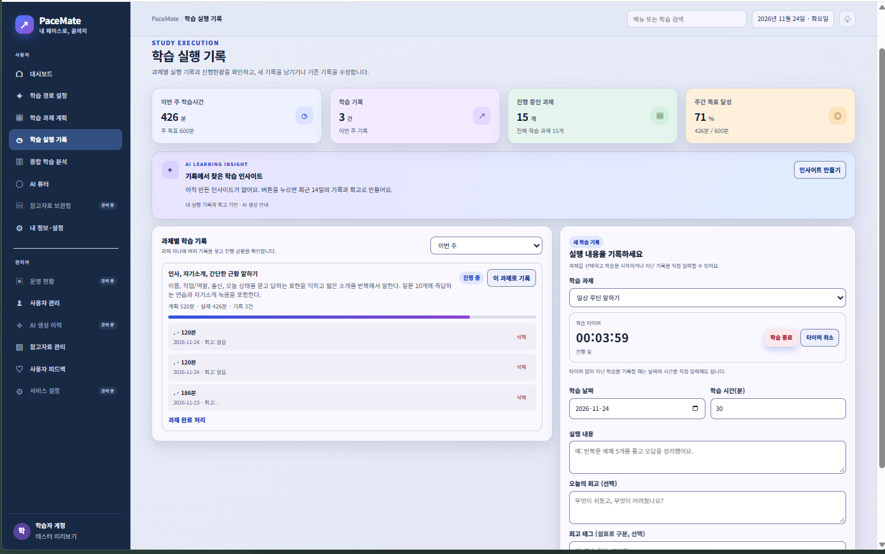
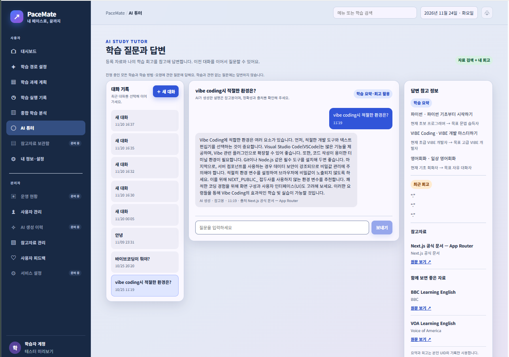
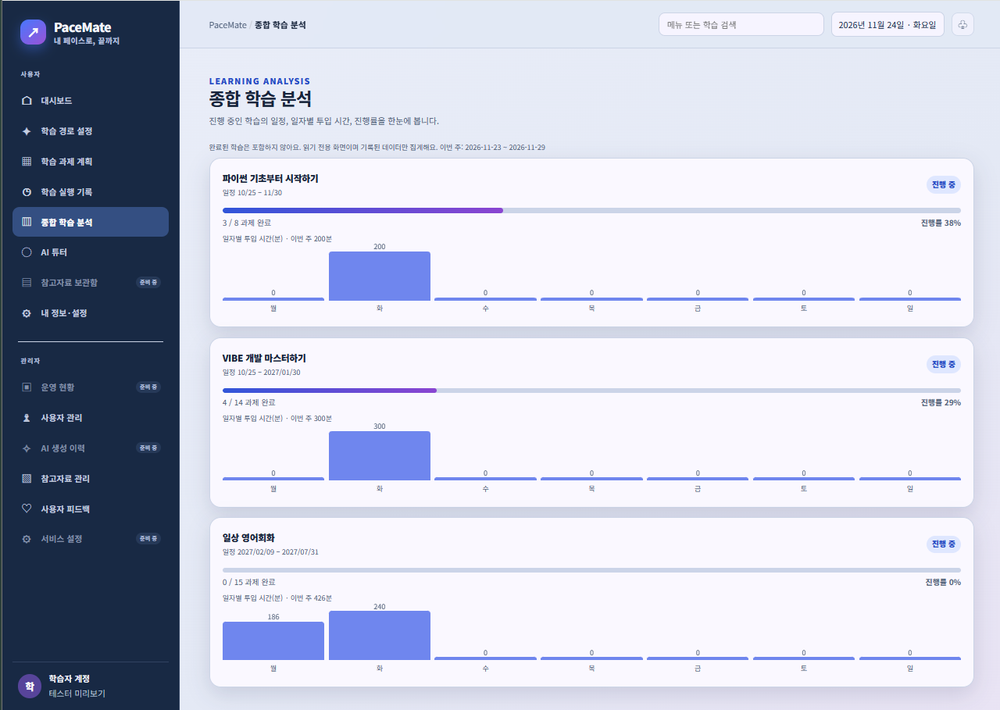
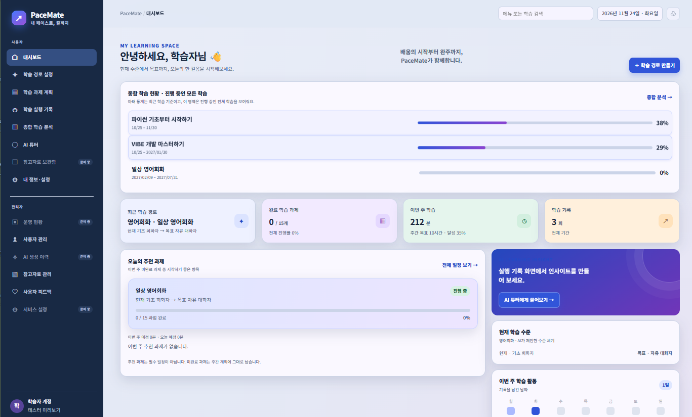
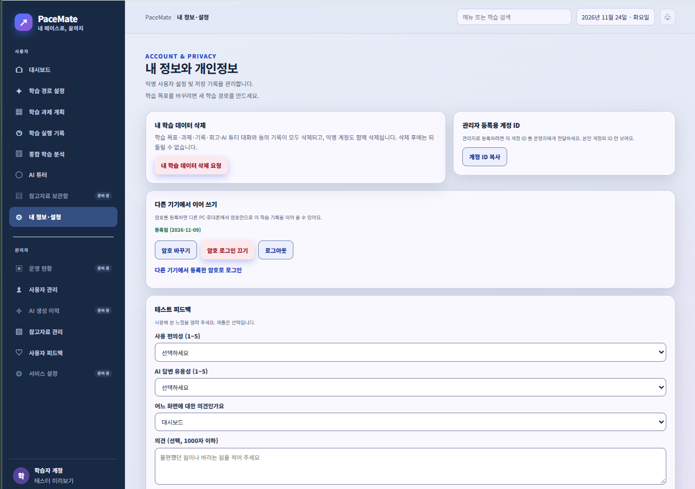
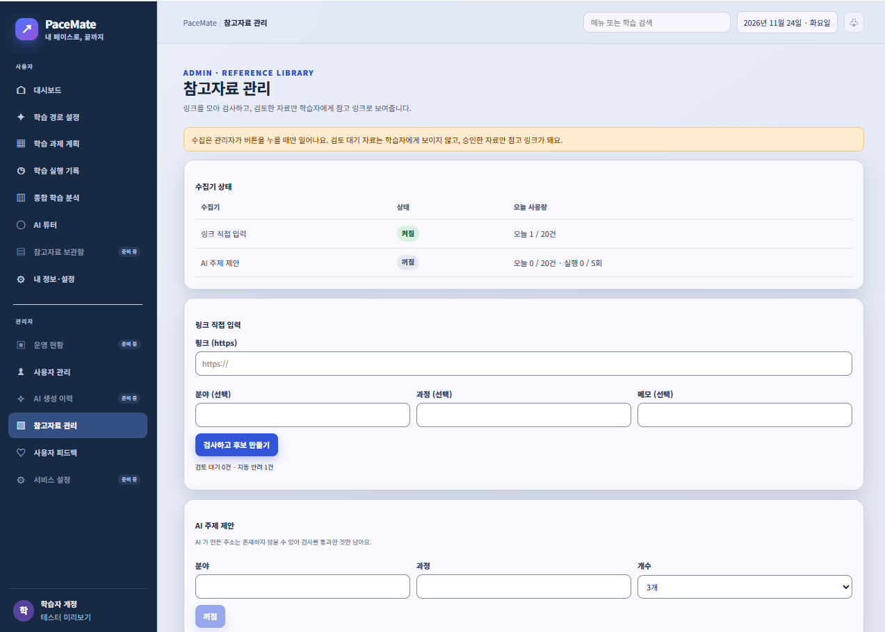

# PaceMate 사용자 매뉴얼

**PaceMate** 는 학습 분야와 관계없이 장기 목표를 가진 독학 학습자를 위한 AI 학습 파트너입니다. 목표를 정하고, AI 가 제안한 학습 계획을 고쳐 확정한 뒤, 매일 공부를 기록하고 AI 튜터에게 질문하며 끝까지 완주하도록 돕습니다.

- **서비스 주소:** https://ai-n-fprj.vercel.app/
- 이 문서의 화면은 실제 배포된 서비스에서 캡처했습니다.

## 1. 시작하기

1. 본인이 평소 쓰는 PC 나 휴대폰 브라우저로 위 주소를 엽니다. 로그인 정보가 그 브라우저에 저장되어 다음에 열면 이어서 쓸 수 있습니다.
2. 처음 열면 **"서버를 준비하고 있습니다. 잠시만 기다려 주세요."** 가 1분 가까이 보일 수 있습니다. 무료 서버가 쉬고 있다가 깨어나는 시간이니 기다려 주세요. 90초가 지나면 **다시 시도** 버튼이 나옵니다.
3. 첫 화면에서 개인정보와 AI 사용 안내를 읽고 동의하면 시작됩니다. **이름, 이메일 같은 개인 정보는 받지 않습니다.**

<!-- 캡처 01: 첫 화면(동의 안내) -->

> 학습 목표나 회고에 본인 이름, 연락처 같은 개인 정보는 쓰지 마세요.

## 2. 화면 구성

왼쪽 메뉴에서 화면을 옮깁니다.

| 메뉴 | 하는 일 |
|---|---|
| 대시보드 | 진행 중인 학습의 진행률과 오늘의 추천 과제를 한눈에 봅니다. |
| 학습 경로 설정 | 분야, 현재·목표 수준, 기간을 정하고 AI 가 만든 학습 계획 초안을 확정합니다. |
| 학습 과제 계획 | 확정한 계획을 주 단위로 보고, 과제별 추천 요일을 바꾸고, AI 학습 조언과 연결된 참고자료를 봅니다. |
| 학습 실행 기록 | 타이머나 직접 입력으로 공부 시간을 기록하고, 과제를 완료 처리하고, 회고를 남깁니다. |
| 종합 학습 분석 | 진행 중인 학습의 일정, 일자별 투입 시간, 진행률을 한눈에 봅니다(읽기 전용). |
| AI 튜터 | 공부하다 막힌 것을 질문합니다. |
| 내 정보·설정 | 다른 기기에서 이어 쓰기, 학습 데이터 삭제, 피드백 보내기를 합니다. |

## 3. 이렇게 사용합니다 (순서대로)

### 3-1. 학습 경로 설정
1. 공부하려는 **분야**를 입력하고 **목표 추천** 을 누르면, AI 가 그 분야에서 많이 목표로 삼는 직무를 예시로 보여 줍니다. 직무를 누르면 **학습 목표** 칸에 채워집니다. 직접 고쳐 써도 됩니다.
2. **과정 추천받기** 를 누르면 AI 가 세부 과정을 제안합니다. 마음에 드는 과정 하나를 고르면 과정명과 설명을 고칠 수 있습니다.

3. **현재 수준** 과 **도달 목표 수준** 을 고르고, 주간 학습 가능 시간과 학습 시작일, 목표 완료 희망일을 정합니다. 수준은 번호가 아니라 분야별 서술형 이름으로 보여 줍니다. 같은 기간에 진행할 수 있는 학습은 최대 2개입니다.
4. **과제·조언·참고자료 만들기** 를 누릅니다.

5. 화면 오른쪽의 **AI 학습 설계 미리보기** 에 주차별 과제 초안이 나타납니다. 이 초안은 **저장 전 초안** 입니다. 과제마다 이름, 설명, 소요 시간(분), 요일을 고치거나 **과업 삭제** 로 뺄 수 있습니다. 총 예상 시간과 가용 시간, 주차별 예정 시간도 함께 보여 줍니다. 초안을 확인한 뒤 **계획 확정** 을 누르면 그때 저장됩니다. 확정하기 전에는 저장되지 않습니다.

- 작성 중에 다른 메뉴로 이동하려 하면 **이동 / 계획 제거 / 취소** 를 고르는 창이 나옵니다. **이동** 은 작성 내용을 이 탭에 보관한 채 이동하고(돌아오면 이어서 쓸 수 있음), **계획 제거** 는 작성 중인 내용을 지우고 이동하며, **취소** 는 화면에 머뭅니다. 탭을 닫으면 보관된 내용은 사라집니다.

### 3-2. 학습 과제 계획
확정한 계획을 주 단위로 봅니다. **이전 주 / 다음 주** 로 주를 옮기고, 과제마다 **추천 요일** 을 바꿀 수 있습니다(변경은 자동 저장됩니다). 오른쪽에는 **AI 학습 조언** 과 **연결된 참고자료**(원문 보기 링크)가 있습니다. 위쪽의 **현재 학습** 에서 다른 학습으로 바꿔 볼 수 있습니다.

- 과제의 **추천 요일은 마감일이 아닙니다.** 놓쳐도 연체나 실패로 처리하지 않습니다.
- **직접 검색해 보기**(구글, 공식 문서, 유튜브) 링크는 팀이 검토하기 전의 외부 링크라고 표시됩니다.

### 3-3. 학습 실행 기록
오른쪽 **새 학습 기록** 에서 학습 과제를 고르고 **타이머**로 공부 시간을 재거나, 학습 날짜와 시간(분)을 직접 입력해 기록합니다. 실행 내용과 **오늘의 회고**(선택), 회고 태그도 남길 수 있습니다. 왼쪽 **과제별 학습 기록** 에는 과제마다 기록이 쌓이고, 끝난 과제는 **과제 완료 처리** 를 눌러 완료합니다.

- 위쪽 카드는 이번 주 학습시간, 학습 기록 수, 진행 중 과제 수, 주간 목표 달성률을 보여 줍니다.
- **인사이트 만들기** 를 누르면 최근 14일의 기록과 회고로 AI 인사이트를 만듭니다.
- 진행률은 **완료한 과제 수 / 전체 과제 수** 입니다.
- 회고는 이후 AI 튜터의 답변에 반영됩니다(최근 회고 최대 5건).

### 3-4. AI 튜터
공부하다 막힌 것을 질문하면 AI 가 등록한 학습 요약과 내 회고를 바탕으로 답합니다. 답변 아래에 **출처** 가 표시되고, 오른쪽 **답변 참고 정보** 에는 참고한 학습 요약, 최근 회고, 참고자료가 나옵니다. 왼쪽 **대화 기록** 에서 이전 대화를 이어서 질문할 수 있습니다. 학습과 관련 없는 질문에는 답하지 않습니다.

- AI 의 답은 참고용입니다. 틀린 내용이 있으면 피드백으로 알려 주세요.
- 참고자료가 없는 분야는 근거가 없다고 안내합니다.

### 3-5. 종합 학습 분석
진행 중인 학습마다 일정, 진행률(완료 과제 수), 이번 주 일자별 투입 시간(분)을 막대로 보여 줍니다. 완료된 학습은 포함하지 않습니다. 읽기 전용 화면입니다.

### 3-6. 대시보드
진행 중인 모든 학습의 진행률, 완료한 과제 수, 이번 주 학습 시간과 기록 횟수, 오늘의 추천 과제를 한눈에 보여 줍니다. 완료한 과제가 없으면 진행률이 **0%** 로 보이는 것은 정상입니다(아래 화면의 "일상 영어회화").

## 4. 내 정보·설정

**내 정보와 개인정보** 화면에서 아래 일을 합니다.

### 4-1. 다른 기기에서 이어 쓰기 (암호)

PC 에서 쓰던 기록을 휴대폰이나 다른 PC 에서도 보고 싶을 때 씁니다.

1. **등록:** 쓰던 기기에서 **내 정보·설정 → 다른 기기에서 이어 쓰기** 카드에 암호와 암호 확인을 입력합니다. 암호는 8자 이상, 영문·숫자·특수문자를 모두 포함하고 공백이 없어야 합니다.
2. **다른 기기에서:** 첫 화면 위쪽의 **암호로 로그인** 을 누르고 암호를 입력합니다. 이때 "동의하고 시작하기"를 먼저 누르지 마세요. 누르면 빈 기록이 새로 생깁니다. 이미 다른 기록으로 들어가 있는 기기라면 **다른 기기에서 등록한 암호로 로그인** 을 누릅니다.
3. **암호는 꼭 메모하거나 저장하세요.** "암호 찾기"는 없습니다. 로그인된 기기가 남아 있으면 **암호 바꾸기** 로 새 암호를 정할 수 있지만, 모든 기기에서 로그아웃된 상태로 암호를 잊으면 그 기록은 되찾을 수 없습니다.
4. 같은 곳에서 여러 번 틀리면 10분 정도 로그인이 막힙니다. **암호 로그인 끄기** 로 이 기능을 끌 수 있고, **로그아웃** 도 같은 카드에 있습니다.

### 4-2. 내 데이터 지우기

**내 학습 데이터 삭제 요청** 으로 모든 학습 기록(목표, 과제, 기록, 회고, AI 튜터 대화, 동의 기록)과 익명 계정을 지울 수 있습니다. 되돌릴 수 없습니다.

### 4-3. 의견 보내기

불편한 점, 오류, 이상한 AI 답이 보이면 **테스트 피드백** 카드로 보내 주세요(사용 편의성과 AI 답변 유용성 1~5점, 해당 화면, 의견은 선택).

## 5. 관리자 화면 (관리자 전용)

관리자 계정에는 운영 메뉴가 추가로 보입니다(사용자 관리, 참고자료 관리, 사용자 피드백). 사용자 관리는 읽기 전용이며 학습 내용과 개인 식별 정보는 표시하지 않습니다.

**참고자료 관리** 에서는 링크를 모아 검사하고, 검토한 자료만 학습자에게 참고 링크로 보여 줍니다. 수집은 관리자가 버튼을 누를 때만 일어나고, **검토 대기** 자료는 학습자에게 보이지 않습니다. 승인한 자료만 참고 링크가 됩니다.

## 6. 자주 묻는 질문

- **진행률이 0% 예요.** 완료 처리한 과제가 없으면 0% 입니다. 학습 실행 기록에서 과제를 **과제 완료 처리** 하면 올라갑니다.
- **AI 가 틀린 답을 줬어요.** AI 의 답은 참고용입니다. 교재나 공식 자료로 확인하고, 내 정보·설정의 피드백으로 알려 주세요.
- **처음 열 때 오래 걸려요.** 무료 서버가 깨어나는 시간입니다. 1분 정도 기다려 주세요.
- **작성하던 계획이 사라졌어요.** 작성 중인 내용은 이 브라우저 탭에 보관됩니다. 탭을 닫았거나 다른 브라우저·기기에서 열었다면 보이지 않습니다. 계획은 **확정** 했을 때만 저장됩니다.
